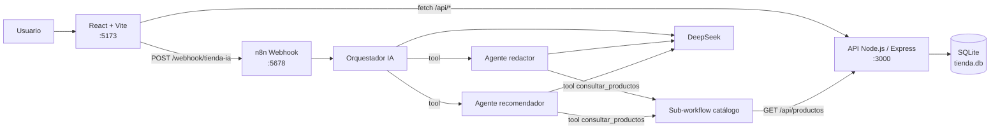
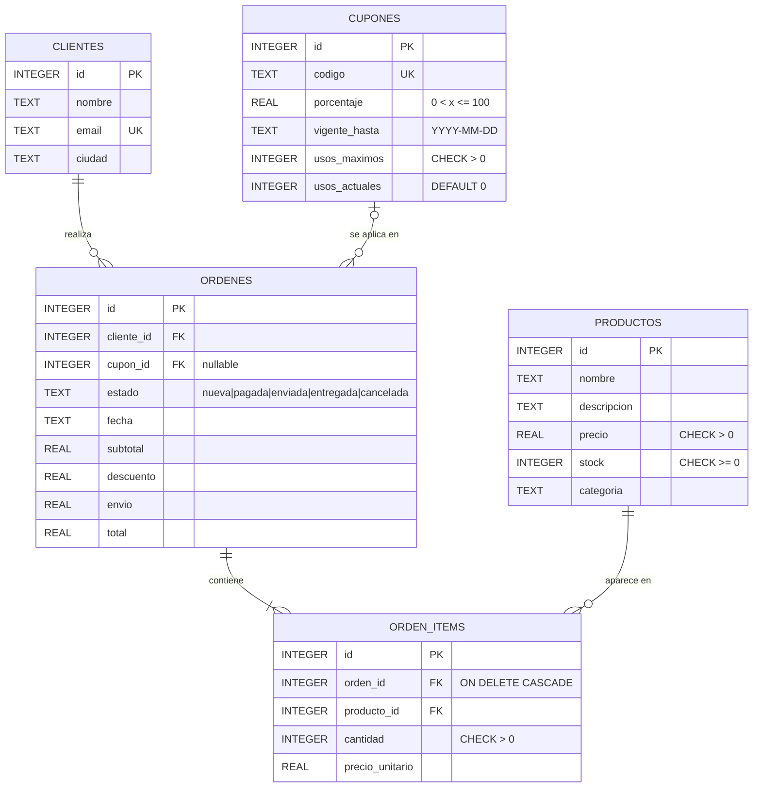
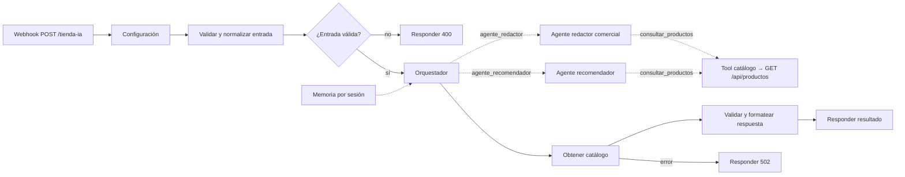

# Tienda Online con Inventario, Cupones y Envíos

**Laboratorio #2 · Caso 5.** Panel de administración de una tienda en línea ubicada en **San José, Costa Rica**. Gestiona inventario, órdenes, cupones de descuento y costos de envío, e incluye un agente de IA en n8n que redacta descripciones comerciales y recomienda productos complementarios del catálogo real.

| Capa | Tecnología |
|------|------------|
| Base de datos | SQLite (`better-sqlite3`) |
| API REST | Node.js + Express (arquitectura por capas) |
| Frontend | React 18 + Vite 7 + React Router 7 |
| Automatización e IA | n8n 2.x: orquestador + 2 agentes especialistas (DeepSeek), tool de catálogo y memoria |

---

## Funcionalidades

- **Órdenes con transacción SQL** (`BEGIN` / `COMMIT` / `ROLLBACK`): valida el stock y el cupón, calcula el descuento y el envío, guarda la orden y sus items, descuenta el stock y consume el cupón en una sola operación atómica.
- **Flujo de estados** `nueva → pagada → enviada → entregada`. Solo se cancelan órdenes `nueva` o `pagada`, y al cancelar se repone el stock.
- **Envío por ciudad**: $5 dentro de San José, $15 al resto de Costa Rica y gratis si el subtotal con descuento supera $100.
- **Dashboard de métricas** con agregaciones SQL (`SUM`, `COUNT`, `AVG`, `GROUP BY`).
- **Catálogo** con búsqueda, filtro por categoría y ordenamiento por precio o stock.
- **Asistente comercial IA**: descripción de venta y dos recomendaciones de venta cruzada verificadas contra el inventario.

## Arquitectura



**Capas del backend:** `routes` (define las URLs) → `controllers` (traducen HTTP ↔ servicio) → `services` (reglas de negocio y consultas SQL parametrizadas) → `db.js` (conexión con `PRAGMA foreign_keys = ON`).

## Modelo de datos



`orden_items.precio_unitario` guarda el precio al momento de la compra. Así, un cambio de precio posterior no altera las órdenes históricas.

---

## Puesta en marcha

### Requisitos

- Node.js **20.19 o superior** (probado con 24.13)
- n8n 2.x local (probado con 2.38.6, instalado con `npm install -g n8n`) y una credencial de DeepSeek en n8n (o de otro proveedor de modelos)

### 1. Base de datos SQLite

La base se crea sola a partir de `backend/schema.sql` (tablas y datos de prueba) la primera vez que arranca la API. Para reiniciarla:

```bash
cd backend
npm install
npm run db:reset
```

Datos de prueba: 6 productos, 3 clientes, 3 órdenes y 3 cupones. `BIENVENIDA10` está vigente, `VERANO20` está vencido y `FLASH50` está agotado.

### 2. API Node.js

```bash
cd backend
cp .env.example .env
npm run dev          # o: npm start
```

Resultado esperado: `Servidor escuchando en http://localhost:3000`. Para comprobarlo, abre `GET http://localhost:3000/health` y debe responder `{ "estado": "ok" }`.

### 3. Frontend React

```bash
cd frontend
cp .env.example .env
npm install
npm run dev
```

Abre `http://localhost:5173`. Si ese puerto está ocupado, Vite usa el 5174, que también está permitido en CORS.

> **Windows con Smart App Control / Application Control:** si `vite build` falla con *"An Application Control policy has blocked this file"* (`rollup.win32-x64-msvc.node`), el `package.json` ya incluye un `overrides` que reemplaza el binario nativo de Rollup por `@rollup/wasm-node`. Si el error persiste, borra `node_modules` y `package-lock.json` y vuelve a ejecutar `npm install`.

### 4. Workflow de n8n

Importa y publica los 4 workflows desde la terminal, **con n8n detenido**. Se enlazan entre sí por IDs fijos, así que no hay que seleccionar nada a mano:

```bash
cd n8n
n8n import:workflow --input=tienda-ia-tool-consultar-productos.json
n8n import:workflow --input=tienda-ia-agente-redactor.json
n8n import:workflow --input=tienda-ia-agente-recomendador.json
n8n import:workflow --input=tienda-ia-orquestador.json
n8n publish:workflow --id=TiendaToolProd01
n8n publish:workflow --id=TiendaAgRedact01
n8n publish:workflow --id=TiendaAgRecome01
n8n publish:workflow --id=TiendaAgenteIA01
n8n start
```

Resultado esperado en la consola: 4 líneas `Activated workflow "[Tienda] IA - …"`.

| Workflow | ID | Editor |
|----------|----|--------|
| Orquestador comercial (webhook) | `TiendaAgenteIA01` | http://localhost:5678/workflow/TiendaAgenteIA01 |
| Agente redactor comercial | `TiendaAgRedact01` | http://localhost:5678/workflow/TiendaAgRedact01 |
| Agente recomendador | `TiendaAgRecome01` | http://localhost:5678/workflow/TiendaAgRecome01 |
| Tool consultar_productos | `TiendaToolProd01` | http://localhost:5678/workflow/TiendaToolProd01 |

- **Ejecuciones del orquestador:** http://localhost:5678/workflow/TiendaAgenteIA01/executions
- **Webhook de producción:** `POST http://localhost:5678/webhook/tienda-ia`

Notas:

1. Los 3 nodos **Modelo DeepSeek** (orquestador, redactor y recomendador) usan `deepseek-chat` con la credencial *DeepSeek Productos*. Para cambiar la API key, abre esa credencial en n8n (**Overview → Credentials**) y pega la nueva; los 3 agentes la toman a la vez. En otra instancia, asigna tu propia credencial o cambia el nodo por otro proveedor (OpenAI, Anthropic, Gemini).
2. `api_url` en los nodos **Configuración** es `http://localhost:3000`. Con n8n en Docker, usa `http://host.docker.internal:3000`.
3. Si importas desde la interfaz en lugar de la CLI, importa en el orden de arriba y publica los 4 workflows con el botón **Publish**. Mientras pruebas desde el editor, la URL es `/webhook-test/tienda-ia`; si usas esa, cámbiala también en `frontend/.env`.

---

## Variables de entorno

**`backend/.env`**

| Variable | Descripción | Ejemplo |
|----------|-------------|---------|
| `PORT` | Puerto de la API | `3000` |
| `DB_PATH` | Archivo SQLite (relativo a `backend/`) | `tienda.db` |
| `CORS_ORIGIN` | Orígenes permitidos, separados por coma (vacío = todos, solo desarrollo) | `http://localhost:5173,http://localhost:5174` |
| `CIUDAD_LOCAL` | Ciudad con tarifa local de envío | `San José` |
| `ENVIO_LOCAL` / `ENVIO_OTRAS_CIUDADES` | Costos de envío | `5` / `15` |
| `ENVIO_GRATIS_DESDE` | Envío gratis si el subtotal con descuento supera este monto | `100` |

**`frontend/.env`**

| Variable | Descripción | Ejemplo |
|----------|-------------|---------|
| `VITE_API_URL` | URL base de la API | `http://localhost:3000` |
| `VITE_N8N_WEBHOOK_URL` | Webhook del agente de IA | `http://localhost:5678/webhook/tienda-ia` |

Las variables `VITE_*` son públicas porque llegan al navegador. Nunca pongas llaves secretas en el frontend: la API key del modelo vive solo en las credenciales de n8n.

---

## Endpoints REST

Todos los errores responden con el formato `{ "error": "mensaje" }`.

| Método | Ruta | Descripción | Códigos |
|--------|------|-------------|---------|
| GET | `/health` | Estado del servidor | 200 |
| GET | `/api/productos?categoria=` | Lista productos (filtro opcional) | 200 |
| GET | `/api/productos/:id` | Detalle de producto | 200, 400, 404 |
| POST | `/api/productos` | Crea producto | 201, 400 |
| PUT | `/api/productos/:id` | Reemplaza producto | 200, 400, 404 |
| DELETE | `/api/productos/:id` | Elimina producto (si no tiene órdenes) | 200, 400, 404, 409 |
| GET | `/api/clientes` | Lista clientes | 200 |
| GET | `/api/cupones` | Lista cupones | 200 |
| GET | `/api/cupones/:codigo` | Detalle de cupón | 200, 404 |
| POST | `/api/cupones` | Crea cupón | 201, 400, 409 (código duplicado) |
| GET | `/api/ordenes?estado=&cliente_id=` | Lista órdenes con cliente y cupón | 200, 400 |
| GET | `/api/ordenes/:id` | Orden con sus items | 200, 400, 404 |
| POST | `/api/ordenes` | Crea orden (transacción) | 201, 400, 404, 409 |
| PATCH | `/api/ordenes/:id/estado` | Avanza o cancela la orden | 200, 400, 404, 409 |
| GET | `/api/resumen` | Métricas de ventas | 200 |

### `POST /api/ordenes`

```json
{
  "cliente_id": 2,
  "items": [{ "producto_id": 4, "cantidad": 1 }],
  "cupon_codigo": "BIENVENIDA10"
}
```

| Código | Cuándo |
|--------|--------|
| 201 | Orden creada; devuelve la orden con `subtotal`, `descuento`, `envio`, `total` e `items` |
| 400 | Faltan campos, tipos inválidos o el cupón no existe |
| 404 | El cliente o algún producto no existe |
| 409 | Stock insuficiente, cupón vencido, cupón agotado o el cliente ya usó ese cupón |

Ante cualquier error se hace `ROLLBACK` y ni el stock ni el cupón cambian.

### `PATCH /api/ordenes/:id/estado`

Body: `{ "estado": "pagada" }`.

| Código | Cuándo |
|--------|--------|
| 200 | Transición válida (`nueva→pagada→enviada→entregada`) o cancelación permitida |
| 400 | Estado inexistente o salto inválido (por ejemplo, `nueva → enviada`) |
| 404 | La orden no existe |
| 409 | Cancelar una orden `enviada`, `entregada` o ya `cancelada` |

### `GET /api/resumen`

```json
{
  "total_ventas": 143.5,
  "ordenes_vendidas": 2,
  "ventas_por_categoria": [{ "categoria": "Electrónica", "unidades": 2, "total": 90 }],
  "top_3_productos": [{ "id": 2, "nombre": "Audífonos Bluetooth", "categoria": "Electrónica", "cantidad_vendida": 2 }],
  "valor_promedio_orden": 71.75
}
```

Solo cuentan las órdenes `pagada`, `enviada` y `entregada`. `ventas_por_categoria` es el importe bruto (cantidad × precio unitario), sin descuento ni envío.

---

## Sistema multi-agente en n8n

**Función:** generador comercial y recomendador de venta cruzada. Recibe un carrito o un producto nuevo, redacta una descripción comercial y recomienda 2 productos complementarios del catálogo real.

**Arquitectura Orquestador → agentes especialistas.** El orquestador no redacta ni recomienda: decide el orden, delega en cada especialista, revisa los resultados (puede pedir una corrección) y combina la respuesta. Cada especialista es un workflow con su propio AI Agent, su prompt y sus herramientas.



| Pieza | Detalle |
|-------|---------|
| Disparador | `POST /webhook/tienda-ia` (CORS limitado al frontend) |
| Orquestador | AI Agent (Tools Agent), máximo 8 iteraciones, memoria de 10 mensajes por `session_id`. Sus tools son los dos agentes (*Call n8n Workflow Tool*) |
| Agente redactor | Workflow `TiendaAgRedact01`: escribe la descripción comercial (2-4 frases, máximo 600 caracteres, precios en USD). Puede consultar el catálogo |
| Agente recomendador | Workflow `TiendaAgRecome01`: consulta el catálogo con `consultar_productos` y devuelve 2 productos con stock que no estén en el carrito |
| Paso de datos | La entrada validada se envía a cada agente **por código** (expresión fija), no la copia el modelo. El orquestador solo agrega `instrucciones` opcionales de enfoque o corrección |
| Prompts | Cada agente tiene su rol acotado, tono costarricense, prohibición de inventar productos o precios, defensa contra inyección de instrucciones y formato de salida estricto |
| Verificación | El nodo *Validar y formatear respuesta* descarta IDs que no estén en el catálogo, sin stock o ya en el carrito, y toma el nombre y el precio de la API, no del modelo |

**Solicitud**

```bash
curl -X POST http://localhost:5678/webhook/tienda-ia \
  -H "Content-Type: application/json" \
  -d '{"session_id":"demo-1","items":[{"producto_id":4,"nombre":"Cafetera de goteo","categoria":"Hogar","cantidad":1}]}'
```

También acepta `"producto_nuevo": { "nombre", "categoria", "descripcion", "precio" }` en lugar de `items`.

**Respuesta (contrato estandarizado)**

```json
{
  "ok": true,
  "data": {
    "descripcion_comercial": "Empieza el día con café recién hecho...",
    "recomendaciones": [
      { "producto_id": 5, "nombre": "Lámpara LED de escritorio", "categoria": "Hogar", "precio": 25, "stock": 39, "motivo": "..." }
    ]
  },
  "error": null
}
```

Si la entrada es inválida responde 400; si el modelo falla o devuelve un formato inválido responde 502. En ambos casos el cuerpo es `{ "ok": false, "data": null, "error": "..." }`.

---

## Frontend

| Ruta | Vista |
|------|-------|
| `/` | Dashboard: KPIs, ventas por categoría y top 3 productos (`/api/resumen`) |
| `/productos` | Catálogo con buscador, filtro por categoría y ordenamiento por nombre, precio o stock |
| `/ordenes` | Tabla con filtro por estado, detalle desplegable, avance de estado y botón **Cancelar orden** (maneja el 409) |
| `/nueva-orden` | Formulario controlado: cliente, carrito, cupón; muestra los errores 400/404/409 de la API e incluye el **Asistente comercial IA** |

- **`services/api.js`**: única capa que hace `fetch` a la API. Convierte las respuestas no exitosas en `ApiError` con `status` y el mensaje del backend.
- **`hooks/useFetch.js`**: devuelve `{ data, loading, error, refetch }` y cancela la petición anterior con `AbortController`.
- **`models/`**: clases espejo (mirror). `Orden` expone `esCancelable`, `siguienteEstado`, `totalFormateado` y `badgeColor`. `Producto` expone `disponibilidad`, `precioFormateado` y `stockFormateado`.

## Estructura del proyecto

```
Laboratorio2/
├── backend/
│   ├── schema.sql              # tablas + datos de prueba
│   ├── server.js               # Express, CORS, dotenv, rutas
│   ├── scripts/reset-db.js
│   └── src/
│       ├── db.js               # conexión + PRAGMA foreign_keys + helper de transacción
│       ├── config.js           # variables de entorno validadas
│       ├── routes/             # productos, ordenes, cupones, clientes, metrics
│       ├── controllers/
│       ├── services/           # reglas de negocio y SQL parametrizado
│       ├── middlewares/        # manejo central de errores
│       └── utils/              # AppError, validaciones
├── frontend/
│   └── src/
│       ├── services/           # api.js, ia.js
│       ├── hooks/              # useFetch, useCarrito
│       ├── models/             # Orden, Producto
│       ├── pages/              # Dashboard, Productos, Ordenes, NuevaOrden
│       ├── components/         # Layout, RecomendadorIA, Carrito, OrdenDetalle, Feedback
│       └── styles/             # tokens.css (tema claro/oscuro), global.css
├── n8n/
│   ├── tienda-ia-orquestador.json              # webhook + orquestador
│   ├── tienda-ia-agente-redactor.json          # agente especialista
│   ├── tienda-ia-agente-recomendador.json      # agente especialista
│   └── tienda-ia-tool-consultar-productos.json # tool compartida
├── BITACORA_IA.md
└── README.md
```

## Decisiones de diseño

- **Descuento y envío solo en el servidor.** El frontend muestra un subtotal estimado, pero no duplica las reglas de negocio.
- **Cupón inexistente → 400; vencido, agotado o ya usado → 409.** Un código que no existe es un dato inválido; los demás casos son reglas de negocio.
- **Cupones y cancelación.** Un cupón usado en una orden cancelada sigue contando como usado y no se devuelve el uso.
- **El botón Cancelar se deshabilita** cuando `esCancelable` es falso. El 409 se sigue manejando para el caso en que otra persona cambia la orden mientras la tabla está abierta.
- **El frontend llama al webhook de n8n directamente**, como pide el laboratorio. En producción conviene pasar por la API con autenticación (Header Auth) y rate limiting.
# Laboratorio2

